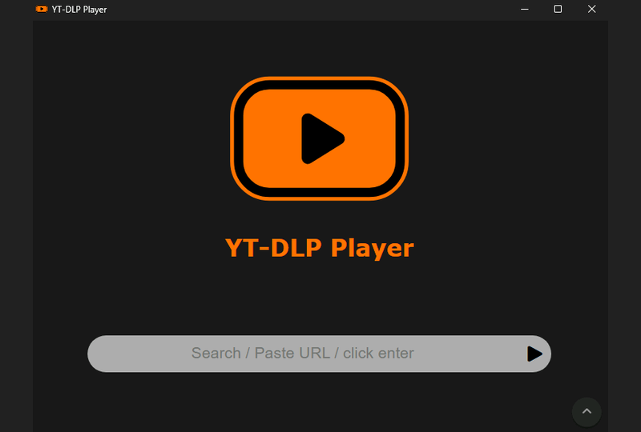
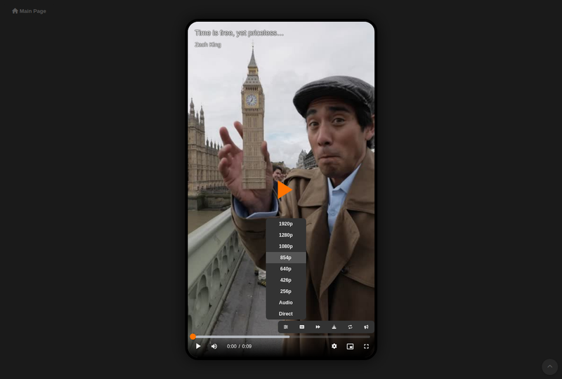
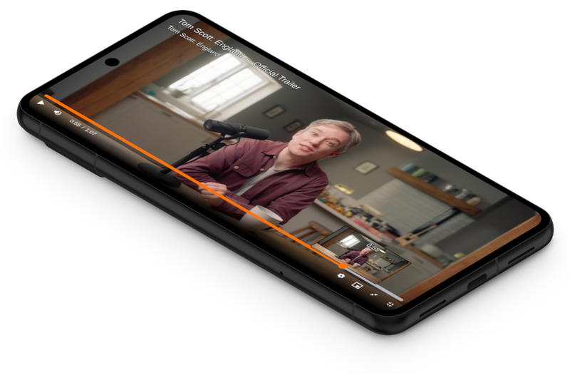
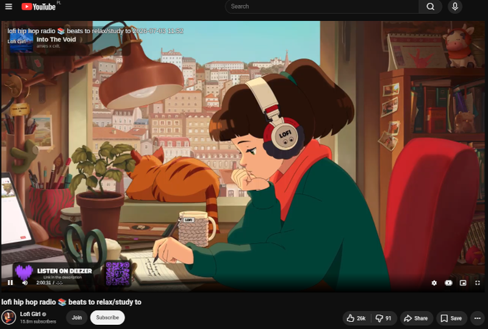

<div align="center">
  

# YT-DLP Web Player

### Internet video player powered by yt-dlp

<br>

[](https://github.com/Matszwe02/ytdlp_web_player/blob/main/LICENSE)
[](https://GitHub.com/Matszwe02/ytdlp_web_player/commit/)

[](https://GitHub.com/Matszwe02/ytdlp_web_player/stargazers/)
[](https://hub.docker.com/r/matszwe02/ytdlp_web_player/)
[](https://GitHub.com/Matszwe02/ytdlp_web_player/issues/)

</div>


## Features
- **Daily auto update of yt-dlp to immediately support new yt-dlp codecs and sites**
- everything you would expect from a modern player
- fast loading speed (most videos load within 3s)
- livestream support
- minimalistic UI, configurable theme color
- paste video URL / type search query / auto pasting from clipboard
- zoom to fill for all devices
- download and loop videos
- optional music visualizer
- browser extension
- installable PWA
- HTTP proxy support with automatic fallback

Some of these features are off by default and need to be turned on in `.env`.


<table align="center">
  <tr>
    <td align="center" valign="top" width="50%">
      <b>Multi-Platform</b><br>Server app for Linux and Windows, docker images, unraid app
    </td>
    <td align="center" valign="top" width="50%">
      <b>Vertical Video Support</b><br>Player automatically adjusts its aspect ratio to each video, in fullscreen you can zoom to fill
    </td>
  </tr>
  <tr>
    <td align="center" valign="top" width="50%">
      
    </td>
    <td align="center" valign="top" width="50%">
      
    </td>
  </tr>
  <tr>
    <td align="center" valign="top" width="50%">
      <b>Phone App</b><br>Installable as PWA app - native phone experience, opening links with "share with YT-DLP Player"
    </td>
    <td align="center" valign="top" width="50%">
      <b>Browser Extension</b><br>Replace all videos seamlessly - consistent UI across every website
    </td>
  </tr>
  <tr>
    <td align="center" valign="top" width="50%">
      
    </td>
    <td align="center" valign="top" width="50%">
      
    </td>
  </tr>
</table>


## Planned
- video quality changing without interrupts
- user-side player configuration


## Limitations
- only YT-DLP supported videos work
- video loading times and fallbacks:
    - most videos load in around 3 seconds
    - if it fails, transcoding starts and video loads in around 10s
    - if it also fails, the whole video is getting downloaded until it becomes available


## Technologies used
- yt-dlp as a video downloader
- videojs as a robust player
- HLS transcoding for the most reliable playback
- ffmpeg for better format support
- node / deno for solving YT-DLP's js challenges
- sponsorblock integration
- Media Session API integration for system playback controls
- Audio Context API for audio over-amplification and music visualizer


## How to run

App should be accessible at http://localhost:5000

### Docker
- `docker run -p 5000:5000 matszwe02/ytdlp_web_player:stable`
    - stable version, ready for everyday use
- `docker run -p 5000:5000 matszwe02/ytdlp_web_player:latest`
    - latest version - may have new and experimental features

Or with Docker Compose:

- Clone the repo
- Run `docker compose up`
- For automatic app updates, see `compose.yml`
- To enable environment:
    - Uncomment:
        ```
        # env_file:
        #     - src/.env
        ```
    - Copy `src/example.env` to `src/.env`, modify as needed


### Run locally (Python)

- Create and activate a virtual environment in `src/` and install `requirements.txt`
- optionally install `ffmpeg` and `node`/`deno`, otherwise they will be automatically installed to your venv
- run `main.py`
- To enable environment:
    - Copy `src/example.env` to `src/.env`, modify as needed


### PC Application (Windows / Linux)

> Due to the packaging of necessary python modules, yt-dlp update may break on older builds when yt-dlp updates its dependencies. In this case a manual app update is necessary

- Download from [Releases](https://github.com/Matszwe02/ytdlp_web_player/releases/latest) and run
  - **YT-DLP Web Player** - a windowed app that also exposes port 5000 to access from any web browser
  - **YT-DLP Web Player CLI** - terminal-only version - a replacement to Python / Docker version

If you want to build this app:

- install python3 and nodejs
- Create and activate a virtual environment
- run `/app/build_app.py`
- app and CLI should appear in `/dist`


### Run with unraid

You can install the official unraid application:

https://ca.unraid.net/apps/yt-dlp-web-player-1ueyzjo0lupqig


## Configuration

All configurable options are environment variables, set in `src/.env` (copy `src/example.env` and uncomment what you want to change).

See `src/example.env` for the full list.


### Hardware Acceleration

FFmpeg automatically detects the best supported hardware encoder. NVIDIA NVENC is used when available, and transcoding automatically falls back to CPU (`libx264`) when hardware acceleration is unavailable or fails.

For NVIDIA GPU acceleration in Docker, [install the NVIDIA Container Toolkit](https://docs.nvidia.com/datacenter/cloud-native/container-toolkit/latest/install-guide.html), uncomment the `build` block that uses `Dockerfile.hwaccel` and `gpus: all` in `compose.yml`, then run `docker compose up --build`.


### Cookies (video streaming sites authentication)

Some video streaming websites need you to be logged in. With cookies you will be logged in to these websites automatically while using the app.

- Create a `src/cookies.txt` file and enable it in `compose.yml` (if using Docker)
- Install an extension such as [Get cookies.txt LOCALLY](https://chromewebstore.google.com/detail/get-cookiestxt-locally/cclelndahbckbenkjhflpdbgdldlbecc) and activate it on the desired website when logged in
  - full guide and explanation can be found in [yt-dlp's wiki](https://github.com/yt-dlp/yt-dlp/wiki/FAQ#how-do-i-pass-cookies-to-yt-dlp)
- Copy the cookies and paste them into that file
- If using extension, you can instead enable automatic sending of browser cookies in extension settings, they will be used automatically

**Keep in mind that cookies work the same way as your account credentials - anyone having them may [mess up your account](https://youtu.be/yGXaAWbzl5A).**
    
I do not guarantee that cookies file is completely secure from accessing it through the player. Additionally yt-dlp uses them when playing videos on behalf of the provided account. So I only recommend putting throwaway accounts here.


### HTTPS and exposing it to the internet

Some features (like extension and PWA) require HTTPS to work.

If you don't own any HTTPS proxy, the easiest solution is to set `PUBLISH_WITH_CLOUDFLARE` environment variable to true and access it through the generated cloudflare link. With this link you can also access this app from anywhere in the world, without the need of port forwarding.

Link is generated and visible in app logs just before app starts.

Note that it is a temporary link that changes each time this app starts. For a more robust way, you need to set up your own proxy with HTTPS certificate.


## Extension

YT-DLP Web Player provides an extension that replaces every video in allowed (in extension settings) domains with YT-DLP Player. That results with all of the default video players to be seamlessly replaced with YT-DLP Player

- This extension will disable all media playback on the website, disable native player and create YT-DLP Player's iframe in its place

There are 3 ways of running this extension:

### Browser Extension

Additionally adds `Open in YT-DLP Player` context menu for all links. So you can right-click any link and it is opened in YT-DLP Player directly

- Extension available in [Chrome Web Store](https://chromewebstore.google.com/detail/yt-dlp-web-player/gnpabpjkhecpnecnlljfjlbbcokccgbj) and [Firefox Add-ons](https://addons.mozilla.org/en-GB/firefox/addon/yt-dlp-web-player/)
    - alternatively, you can clone this repo and load it from `/extension` directory
- Put player's URL in extension settings
- In extension settings: enable/disable domains or start/stop temporarily

### Tampermonkey script

- Install userscript from player's dropdown menu (you need to have `Tampermonkey`/`Violentmonkey` extension installed)
- In script settings: enable/disable domains or start/stop temporarily
- For some websites you need to install one of `disable CSM` extensions

### Developer Tools script

It is a temporary solution, every page reload clears it
- copy extension js from player's dropdown menu (or `/extension/extension.js`) and paste into developer tools
- For some websites you need to install one of `disable CSM` extensions


## Demo, other use cases

### Demo server

Low performance and may be IP blacklisted due to this server's limitations

https://ytdlp-web-player.vercel.app

### Proof-of-Concept YT-DLP Web Player inside Invidious

https://hub.docker.com/r/matszwe02/invidious_ytdlp_web_player

### Sharing

This player fully supports `Open Graph` - sharing it through social media and messaging apps shows video's title, thumbnail, and allows for direct playback

### Embedding player

If you want to embed this player, use `/iframe?url=...` endpoint


## Troubleshooting

### I can't install PWA / embed it as an iframe / extension does not load

You need a working HTTPS for this, see in [HTTPS and exposing it to the internet](#https-and-exposing-it-to-the-internet). Some features will work when you run through HTTP from localhost, but it may not work properly.

### I can't play some videos

Check whether the site is supported by yt-dlp [here](https://github.com/yt-dlp/yt-dlp/blob/master/supportedsites.md).

Also check [yt-dlp's issues](https://github.com/yt-dlp/yt-dlp/issues).

You can even try to download yt-dlp and download that video with it, to ensure there is a way to download it.

If it appears to be supported, file a bug report with app logs.

### Can this app do XYZ?

This readme does not mention every configuration option. See `src/example.env` and check if the feature you want is already settable. If not, I'm open for feature requests.

### Other issues

Please file a bug report. Attach browser and app logs if relevant, app version, browser name, etc.

## Star History

<a href="https://www.star-history.com/?repos=Matszwe02%2Fytdlp_web_player&type=date&legend=top-left">
 <picture>
   <source media="(prefers-color-scheme: dark)" srcset="https://api.star-history.com/chart?repos=Matszwe02/ytdlp_web_player&type=date&theme=dark&legend=top-left&sealed_token=Zl2dzmWUVUFTEUi3gsml_QdK81OsclisvdMzzAPqjx4Mw-hM5yGunbLB7ZfzHSImqHJln6sjfraFdR4NTvzwtayFPXg9KXZxaEKR3QLDjmlz0G6K5PAB-tYNce-2hNRxLaeY-MEnVtwwCD7aUivxdI_aKacEyBcLZfDk2Y8qMMbWBmEbMvcLUezM1uPg" />
   <source media="(prefers-color-scheme: light)" srcset="https://api.star-history.com/chart?repos=Matszwe02/ytdlp_web_player&type=date&legend=top-left&sealed_token=Zl2dzmWUVUFTEUi3gsml_QdK81OsclisvdMzzAPqjx4Mw-hM5yGunbLB7ZfzHSImqHJln6sjfraFdR4NTvzwtayFPXg9KXZxaEKR3QLDjmlz0G6K5PAB-tYNce-2hNRxLaeY-MEnVtwwCD7aUivxdI_aKacEyBcLZfDk2Y8qMMbWBmEbMvcLUezM1uPg" />
   
 </picture>
</a>
